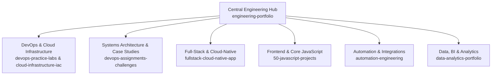

# Central Engineering Portfolio & Architecture Hub

Central architectural hub and master navigation directory for all software engineering, cloud infrastructure, practice labs, and continuous learning repositories maintained by Emaan Humayun.

---

## Ecosystem Architecture

The engineering portfolio is partitioned into dedicated domain repositories. Each domain manages its own source code, configurations, tests, and implementation evidence.

---

## Master Domain Directory

| Technical Domain | Primary Focus | Repositories & Modules | Status |
| :--- | :--- | :--- | :--- |
| **DevOps & Cloud** | Linux administration, Docker containerization, Kubernetes orchestration, Terraform IaC, GitHub Actions CI/CD | • [`automation-integration-hub`](https://github.com/EmaanHumayun/automation-integration-hub) • [`backend-engineering-hub`](https://github.com/EmaanHumayun/backend-engineering-hub) • [`devops-engineering-bootcamp`](https://github.com/EmaanHumayun/devops-engineering-bootcamp) • [`devops-practice-labs`](https://github.com/EmaanHumayun/devops-practice-labs) • [`cloud-infrastructure-iac`](https://github.com/EmaanHumayun/cloud-infrastructure-iac) | `Active Labs` |
| **Architecture & Case Studies** | High availability VPC design, zero-downtime canary rollouts, secure supply-chain CI/CD | • [`devops-assignments-challenges`](https://github.com/EmaanHumayun/devops-assignments-challenges) | `Case Studies` |
| **Full-Stack Engineering** | Microservices, Node.js + Express REST APIs, React frontend, Docker compose, K8s manifests | • [`fullstack-applications`](https://github.com/EmaanHumayun/fullstack-applications) • [`fullstack-cloud-native-app`](https://github.com/EmaanHumayun/fullstack-cloud-native-app) | `Active App` |
| **Core JavaScript & Web** | DOM manipulation, asynchronous algorithms, Fetch API integration, state management | • [`50-javascript-projects`](https://github.com/EmaanHumayun/50-javascript-projects) | `Complete` |
| **Automation & Tooling** | Bash server maintenance, Python API automation, cron job daemons, log parsers | • [`automation-engineering`](https://github.com/EmaanHumayun/automation-engineering) | `In Progress` |
| **Data & Analytics** | Relational SQL queries, data modeling, Power BI reports, exploratory analysis | • [`data-analytics-portfolio`](https://github.com/EmaanHumayun/data-analytics-portfolio) | `In Progress` |
| **AI & Emerging** | Tool-calling loops, LLM integrations, prompt engineering | • [`ai-automation-engineering`](https://github.com/EmaanHumayun/ai-automation-engineering) | `Active` |

---

## Featured Engineering Projects

### 1. [Full-Stack Cloud-Native Microservices Platform](https://github.com/EmaanHumayun/fullstack-cloud-native-app)
- **Problem Statement:** Engineering a production-oriented web platform with independent frontend/backend microservices, resilient containerization, and zero-downtime deployment capabilities.
- **Tech Stack:** React 18, Vite, Tailwind CSS, Node.js, Express.js, Docker, Kubernetes, GitHub Actions.
- **Key Deliverables:** Multi-stage distroless Dockerfiles, health check endpoints (`/healthz`, `/metrics`), declarative K8s manifests (Deployments, Services, ConfigMaps).

### 2. [Multi-AZ AWS Infrastructure as Code (Terraform)](https://github.com/EmaanHumayun/cloud-infrastructure-iac)
- **Problem Statement:** Declarative provisioning of a multi-tier, multi-AZ cloud network adhering to the principle of least privilege and strict network segmentation.
- **Tech Stack:** Terraform / OpenTofu, AWS (VPC, Public/Private Subnets, NAT Gateways, Security Groups).
- **Key Deliverables:** Reusable Terraform modules, remote state locking patterns, automated linting & plan validation workflows.

### 3. [DevOps Practice Labs Curriculum](https://github.com/EmaanHumayun/devops-practice-labs)
- **Problem Statement:** Hands-on mastery of fundamental DevOps tasks from Linux system administration to automated CI/CD and container orchestration.
- **Tech Stack:** Bash, Linux (Ubuntu/Debian), Docker, Kubernetes, Helm, Terraform, Prometheus.
- **Key Deliverables:** 8 structured modules with executable scripts, manifests, and step-by-step problem statements.

### 4. [50 JavaScript Projects Portfolio](https://github.com/EmaanHumayun/50-javascript-projects)
- **Problem Statement:** Mastering foundational client-side engineering, asynchronous JavaScript, event handling, and external API consumption without heavy frameworks.
- **Tech Stack:** Vanilla JavaScript (ES6+), Modern DOM API, CSS3, HTML5.
- **Key Deliverables:** 50 functional web applications demonstrating pure JavaScript capabilities.

---

## Practice Labs & Architecture Assignments Matrix

| Lab / Assignment | Domain | Key Architectural Concept | Artifacts |
| :--- | :--- | :--- | :--- |
| **[Lab 01: Linux & Bash Daemons](https://github.com/EmaanHumayun/devops-practice-labs/tree/main/module-01-linux-automation)** | Systems | Automated log rotation, system health checks, cron triggers | Shell scripts, cron configs |
| **[Lab 02: Multi-Stage Docker](https://github.com/EmaanHumayun/devops-practice-labs/tree/main/module-02-docker-containerization)** | Containers | Image footprint minimization, non-root user execution | Dockerfile, docker-compose.yml |
| **[Lab 03: Kubernetes Manifests](https://github.com/EmaanHumayun/devops-practice-labs/tree/main/module-03-kubernetes-orchestration)** | Orchestration | Rolling updates, liveness/readiness probes, pod security | Deployment, Service, ConfigMap YAML |
| **[Lab 05: Terraform AWS Modules](https://github.com/EmaanHumayun/devops-practice-labs/tree/main/module-05-terraform-opentofu-iac)** | IaC | Declarative resource provisioning, input variable validation | main.tf, variables.tf, outputs.tf |
| **[Lab 06: GitHub Actions CI](https://github.com/EmaanHumayun/devops-practice-labs/tree/main/module-06-cicd-github-actions)** | CI/CD | Automated test runs, security scanning, artifact caching | ci-pipeline.yml |
| **[Assignment 01: Multi-AZ VPC](https://github.com/EmaanHumayun/devops-assignments-challenges)** | Architecture | High availability CIDR subnetting across 3 availability zones | IaC templates, network diagram |
| **[Assignment 02: Zero-Downtime Rollout](https://github.com/EmaanHumayun/devops-assignments-challenges)** | Deployment | Blue/Green deployment switching with zero customer interruption | Ingress routing & service switching |

---

## Engineering Roadmaps & Development Tracking

Track detailed learning goals and milestones across domains:
- **[DevOps & Cloud Engineering Roadmap 2026](./roadmaps/devops-roadmap-2026.md)**
- **[Backend & Distributed Systems Roadmap 2026](./roadmaps/backend-roadmap-2026.md)**

---

## Engineering Standards & Verification

All codebases within this portfolio follow strict engineering guidelines:
1. **Reproducibility:** Every repository includes step-by-step reproduction instructions and prerequisites.
2. **Security:** No hardcoded secrets, API tokens, or `.env` files. Automated `.gitignore` patterns for all environments.
3. **Authenticity:** All code represents actual hands-on implementations or documented learning exercises.
4. **Clean Git History:** Meaningful conventional commit messages (`feat:`, `fix:`, `docs:`, `chore:`).

---

## Professional Coordinates

- **Engineer:** Emaan Humayun
- **Specialization:** Software Engineer | DevOps Engineer
- **Email:** [emaanhumayun23072@gmail.com](mailto:emaanhumayun23072@gmail.com)
- **LinkedIn:** [linkedin.com/in/emaanmuhammadhumayun](https://www.linkedin.com/in/emaanmuhammadhumayun)
- **GitHub:** [@EmaanHumayun](https://github.com/EmaanHumayun)
