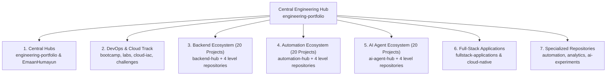

# Central Engineering Portfolio & Architecture Hub

[](https://opensource.org/licenses/MIT)
[](https://github.com/EmaanHumayun)
[](#the-7-core-engineering-pillars)
[](./GIT-WORKFLOW.md)

Central architectural hub and master navigation directory for all software engineering, cloud infrastructure, practice labs, automation pipelines, and agentic AI systems maintained by Emaan Humayun.

---

## Pinned Flagship Repositories

The top 6 primary flagship repositories representing the core disciplines of this ecosystem:

| Repository | Engineering Discipline | Scope & Architecture | Status |
| :--- | :--- | :--- | :--- |
| [**`engineering-portfolio`**](https://github.com/EmaanHumayun/engineering-portfolio) | **Central Portfolio Hub** | Master architectural roadmap, domain matrices, cross-repository index, and engineering standards. | `Active Master Hub` |
| [**`devops-engineering-bootcamp`**](https://github.com/EmaanHumayun/devops-engineering-bootcamp) | **DevOps & Cloud Infrastructure Track** | 10-module curriculum: Linux internals, networking, Docker, K8s, Terraform IaC, CI/CD, and Observability. | `Active Track` |
| [**`backend-engineering-hub`**](https://github.com/EmaanHumayun/backend-engineering-hub) | **Backend Engineering Ecosystem** | 20 progressive projects: REST/GraphQL APIs, dual-tier caching, message queues, and microservices. | `20-Project Hub` |
| [**`automation-integration-hub`**](https://github.com/EmaanHumayun/automation-integration-hub) | **Automation & Integrations Ecosystem** | 20 progressive projects: webhooks, idempotency, CRM sync, DevOps pipelines, and AI orchestrators. | `20-Project Hub` |
| [**`ai-agent-engineering-hub`**](https://github.com/EmaanHumayun/ai-agent-engineering-hub) | **AI Agent Engineering Ecosystem** | 20 progressive systems: tool calling, persistent memory, hybrid RAG, multi-agent SDLC, and AIOps. | `20-Project Hub` |
| [**`fullstack-applications`**](https://github.com/EmaanHumayun/fullstack-applications) | **Full-Stack Applications Portfolio** | Production monorepo featuring Engineering Hub Pro (v2.0) and multi-tier web platforms. | `Active Monorepo` |

---

## About & Engineering Philosophy

This ecosystem demonstrates an authentic, progression-oriented engineering journey across application development, infrastructure architecture, system automation, and agentic AI.

- **First-Principles Foundation:** We master operating system mechanisms, networking primitives, database concurrency, and container runtimes before applying higher-level abstraction frameworks.
- **Clean Architecture & Separation of Concerns:** Domain layers, infrastructure controllers, data access repositories, and deployment manifests maintain strict boundaries.
- **Reproducibility & Verification:** Every project contains deterministic setup scripts, verified dependencies, and automated test assertions.
- **Zero-Secret Security Policy:** Strict credential isolation, automated `.gitignore` patterns, and zero hardcoded tokens across all repositories.

---

## Ecosystem Architecture



---

## The 7 Core Engineering Pillars

### Pillar 1: Central Portfolio Hubs
- [**`engineering-portfolio`**](https://github.com/EmaanHumayun/engineering-portfolio): Central architectural roadmap, domain matrices, system diagrams, and cross-repo navigation.
- [**`EmaanHumayun`**](https://github.com/EmaanHumayun/EmaanHumayun): GitHub profile root, public identity, repository index, and technical competency overview.

### Pillar 2: DevOps & Cloud Infrastructure Track
- [**`devops-engineering-bootcamp`**](https://github.com/EmaanHumayun/devops-engineering-bootcamp): Structured 10-module curriculum covering Linux, Bash, networking, Git, Docker, Kubernetes, Terraform, AWS, and Prometheus.
- [**`devops-practice-labs`**](https://github.com/EmaanHumayun/devops-practice-labs): Reproducible hands-on labs with executable scripts, manifests, and verification runbooks.
- [**`cloud-infrastructure-iac`**](https://github.com/EmaanHumayun/cloud-infrastructure-iac): Modular Terraform and OpenTofu blueprints for multi-AZ AWS VPCs, EKS clusters, and remote S3/DynamoDB state locking.
- [**`devops-assignments-challenges`**](https://github.com/EmaanHumayun/devops-assignments-challenges): In-depth architectural case studies (multi-AZ VPC design, canary deployments, DevSecOps supply chain security).

### Pillar 3: Backend Engineering Ecosystem (20 Progressive Projects)
- [**`backend-engineering-hub`**](https://github.com/EmaanHumayun/backend-engineering-hub): Central index, concept master index, roadmap, and architecture standards.
- [**`backend-beginner-projects`**](https://github.com/EmaanHumayun/backend-beginner-projects): Projects 01-05 (HTTP Servers, CRUD APIs, Authentication & Authorization, Relational Databases, File Processing).
- [**`backend-intermediate-projects`**](https://github.com/EmaanHumayun/backend-intermediate-projects): Projects 06-10 (Caching, Background Queues, Rate Limiting, Real-time WebSockets, Microservices Foundation).
- [**`backend-advanced-projects`**](https://github.com/EmaanHumayun/backend-advanced-projects): Projects 11-15 (Event-Driven Architecture, Distributed Tracing, High-Concurrency Engines, GraphQL, Payment Gateway).
- [**`backend-professional-projects`**](https://github.com/EmaanHumayun/backend-professional-projects): Projects 16-20 (CQRS & Event Sourcing, Multi-Tenant SaaS, Search Engine, Fault Tolerance, Production Microservices Mesh).

### Pillar 4: Automation & Integration Engineering Ecosystem (20 Progressive Projects)
- [**`automation-integration-hub`**](https://github.com/EmaanHumayun/automation-integration-hub): Master roadmap, integrations catalog, webhook standards, and security specifications.
- [**`automation-beginner-projects`**](https://github.com/EmaanHumayun/automation-beginner-projects): Projects 01-05 (Automated Email Notifications, File Processing Pipelines, Scheduled Data Ingestion, Webhook Dispatcher, External API Sync).
- [**`automation-intermediate-projects`**](https://github.com/EmaanHumayun/automation-intermediate-projects): Projects 06-10 (CRM Synchronization Engine, Automated Invoice Generator, Multi-Channel Alert Router, Git/GitHub Automation, Payment Reconciliation).
- [**`automation-advanced-projects`**](https://github.com/EmaanHumayun/automation-advanced-projects): Projects 11-15 (ETL Pipeline Engine, Event-Driven Webhook Broker, CI/CD Pipeline Automation, Infrastructure Provisioning, Cross-Platform Data Sync).
- [**`automation-professional-projects`**](https://github.com/EmaanHumayun/automation-professional-projects): Projects 16-20 (Incident Auto-Remediation, Enterprise Order Workflow, AI-Assisted Document Pipeline, Multi-Cloud Backup, Workflow Engine).

### Pillar 5: AI Agent Engineering & Agentic Systems (20 Progressive Projects)
- [**`ai-agent-engineering-hub`**](https://github.com/EmaanHumayun/ai-agent-engineering-hub): Central curriculum, agent architecture guide, concept mastery index, and technology stack.
- [**`ai-agents-beginner-projects`**](https://github.com/EmaanHumayun/ai-agents-beginner-projects): Projects 01-05 (Personal Assistant, Structured Data Extractor, Research Summary Agent, SQLite Task Agent, Document QA RAG Agent).
- [**`ai-agents-intermediate-projects`**](https://github.com/EmaanHumayun/ai-agents-intermediate-projects): Projects 06-10 (Persistent Memory Agent, Email/Calendar Action Agent, Code Assistant, Hybrid Search RAG, API Integration Agent).
- [**`ai-agents-advanced-projects`**](https://github.com/EmaanHumayun/ai-agents-advanced-projects): Projects 11-15 (Autonomous Planning Agent, Multi-Agent Research System, SDLC Collective, AI Data Analyst, Agent Evaluation Platform).
- [**`ai-agents-professional-projects`**](https://github.com/EmaanHumayun/ai-agents-professional-projects): Projects 16-20 (DevOps AIOps Agent, Customer Support Platform, Business Ops Platform, Autonomous SWE Platform, Enterprise Agent Gateway).

### Pillar 6: Full-Stack Applications Portfolio
- [**`fullstack-applications`**](https://github.com/EmaanHumayun/fullstack-applications): Production monorepo hosting multi-tier applications including Engineering Hub Pro (v2.0) and Task Management Platform.
- [**`fullstack-cloud-native-app`**](https://github.com/EmaanHumayun/fullstack-cloud-native-app): Decoupled React 18 + Node.js/Express platform with Docker containerization and declarative Kubernetes manifests.
- [**`50-javascript-projects`**](https://github.com/EmaanHumayun/50-javascript-projects): 50 foundational web applications demonstrating native DOM manipulation, asynchronous algorithms, and client-side state.

### Pillar 7: Specialized Engineering Repositories
- [**`automation-engineering`**](https://github.com/EmaanHumayun/automation-engineering): Operational Bash daemons, system health monitors, log rotation engines, and Python sync utilities.
- [**`data-analytics-portfolio`**](https://github.com/EmaanHumayun/data-analytics-portfolio): Complex SQL queries, cohort retention analyses, database schemas, and data modeling artifacts.
- [**`ai-automation-engineering`**](https://github.com/EmaanHumayun/ai-automation-engineering): Experimental agent loops, JSON-schema tool calling scripts, and prompt engineering utilities.

---

## Universal Daily Git Workflow

Detailed in full in [**`GIT-WORKFLOW.md`**](./GIT-WORKFLOW.md):

```bash
# 1. Select repository and project directory
cd d:/my\ personal-workspace/github-ecosystem/backend-beginner-projects/02-restful-api-task-manager

# 2. Create feature branch
git checkout -b feat/p02-task-manager

# 3. Develop implementation, test assertions, and docs
# 4. Run automated tests and verify zero secret leaks
npm test && git status

# 5. Commit with atomic conventional commit message
git add src/ tests/ README.md
git commit -m "feat(p02): implement REST task manager endpoints with JWT auth and test suite"

# 6. Merge to main and push
git checkout main
git merge feat/p02-task-manager
git push origin main
git branch -d feat/p02-task-manager
```

---

## Engineering Standards & Verification

All codebases within this portfolio adhere to four mandatory architectural constraints:
1. **Reproducibility:** Every repository includes comprehensive prerequisite documentation, configuration samples, and runbooks.
2. **Security:** No hardcoded secrets, API tokens, or `.env` files. Automated `.gitignore` patterns for all environments.
3. **Authenticity:** All code represents actual hands-on implementations or documented learning exercises.
4. **Clean Git History:** Meaningful conventional commit messages (`feat:`, `fix:`, `docs:`, `chore:`).

---

## Professional Coordinates

- **Engineer:** Emaan Humayun
- **Specialization:** Software Engineer | DevOps Engineer
- **Email:** [emaanhumayun23072@gmail.com](mailto:emaanhumayun23072@gmail.com)
- **LinkedIn:** [linkedin.com/in/emaanmuhammadhumayun](https://www.linkedin.com/in/emaanmuhammadhumayun)
- **GitHub:** [@EmaanHumayun](https://github.com/EmaanHumayun)
